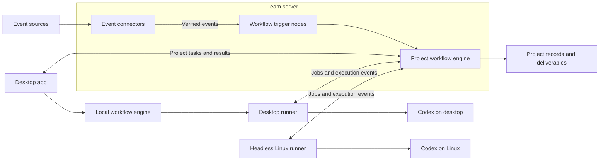

# Meshwork design

[简体中文](design.zh-CN.md) · [Repository README](../README.md)

This document describes the proposed first release of Meshwork. The product model and deployment shape come from the project discussion. The technology choices and first-release defaults are design proposals.

## Product model

Meshwork manages tasks that pass between people and AI agents. A user or an event gives a task to a bot. The bot selects a configured workflow, and the workflow engine advances the task according to its rules. Each handoff records who completed the step, what they produced, and who acts next.

| Concept | Meaning |
| --- | --- |
| Project | A shared workspace with its own team, repositories, reference documents, bots, tasks, and deliverables. An account can join multiple projects. |
| Member | A real person with a Meshwork account and project permissions. Members can receive tasks, submit deliverables, request changes, and approve handoffs. |
| Bot | A personal or project-owned entry point for a workflow. It defines the operating rules and has a visible identity in the task timeline. |
| Workflow | A versioned definition of steps, responsibilities, inputs, expected outputs, and transitions. A responsibility such as reviewer is bound to a person or an agent step. |
| Trigger node | A workflow node that starts a run or advances a waiting step when a configured event matches. It defines the event type, sources, filters, and input mapping. |
| Task | A unit of work with an objective, context, acceptance criteria, a timeline, and deliverables. A task can have multiple workflow runs over time. |
| Run and step attempt | A run records one execution of a specific workflow version. A step attempt records one execution or human submission within that run. |
| Executor and runner | An executor carries out an agent step. Codex is the first planned executor. A runner is the Meshwork process on the machine that starts and manages the executor. |

## Personal and project bots

| | Personal bot | Project bot |
| --- | --- | --- |
| Ownership | Created and managed in the user's desktop workspace. | Created by an authorized project member and owned by the project. |
| Trigger | A user starts a local task from the desktop. | A manual or event trigger node starts a run. An event trigger node can also resume a waiting step. |
| Context | Local directories, user-selected files, and outputs from earlier steps. | Project resources, the triggering event, and deliverables from earlier steps. |
| Execution | The user's desktop runner uses the local Codex installation and workspace. | The team server assigns agent steps to an eligible desktop runner or headless Linux runner. Human steps go to the assigned member's inbox. |
| Results | The personal task and its history stay in local storage. | The task, shared deliverables, and review history are visible to authorized project members. |

The two bot types share the same workflow definition and step semantics. A personal workflow can run on the desktop without signing in to a team server. For project workflows the team server owns the shared task state, including the next assignment. A desktop owner enrolls the runner for the projects they choose and controls whether it takes work automatically.

## Architecture

**Desktop app.** Create personal bots and workflows, join projects, and work from a task inbox. Each task shows its current step, assignee, relevant execution events, and deliverables. The desktop runner handles local execution and can also accept approved project assignments.

**Team server.** Own accounts, project memberships, shared resources, bot configuration, workflow runs, human assignments, and publication records. It receives project events through connectors, evaluates trigger nodes, routes work, and broadcasts task changes. A project available in two desktop clients has one shared task state.

**Runners.** The desktop runner and headless Linux runner share the execution code. Each runner manages its own workspace, Codex process, and provider login. An enrolled runner authenticates to the team server and initiates the connection. An eligible runner must have permission to take the step and the required workspace and executor available. A runner can continue a step independently of the desktop window while its process and machine remain running.

The initial stack proposal is Electron, React, and TypeScript for the desktop, a shared Node.js runner for desktop and Linux, and a Node.js team service. SQLite can store personal workflows, tasks, and execution state. PostgreSQL is proposed for shared project records, with a separate file store for uploaded deliverables. Use HTTPS for requests and webhooks and a persistent connection for dispatch, progress, and status updates.

## Workflow trigger nodes

A trigger node configures when a workflow should run and which event data it should receive. An entry trigger creates a run. A trigger inside a run waits for a matching event before advancing. For example, a code review workflow can start when a new revision is submitted, then wait for the CI result for that revision before handing off to a human reviewer.

| Configuration | What it controls |
| --- | --- |
| Source | A manual action, a webhook, or one or more configured connections and resources. A project may connect several repositories across GitHub and GitLab. Workflows for documents and other tasks can use triggers without a repository. |
| Event and filters | The event to match and conditions such as selected repositories, a target branch, or a CI result tied to the current run. |
| Input mapping | The event fields that become workflow inputs. A code review step receives repository and change identifiers, the revision to review, and a reference to fetch the relevant diff. |
| Activation | Whether the node starts a new run or advances a waiting step. A waiting step matches the event to its run or resource revision. |

Connectors validate incoming webhook deliveries and map provider events to common Meshwork event types. The team server resolves the connection and resource to the project, then evaluates the node's filters. Event records include the source connection and resource identifiers so that matching, deduplication, and result routing work across hosts and repositories. The same code review workflow can be used with either connector by configuring its trigger sources.

Publishing a result is a separate workflow step with its own connector, destination, and permission. It can use the originating change from the event context as its destination. A workflow can also finish with a report stored in Meshwork.

## Workflows and handoffs

The first editor can represent a workflow as an ordered list of steps with explicit transitions for success, requested changes, failure, and a human decision. A step defines its executor or assignee, required inputs, output fields, and next step. A return path can send a review back to the implementer with a retry limit and an escalation to a person. Each run keeps the workflow version it started with.

The workflow engine uses structured step results to choose a transition. An agent can return an outcome, a short summary, and evidence. The runner validates the result against the step definition and gathers the referenced deliverables. Meshwork advances the workflow after it has persisted the result and the required deliverables. A human submits an equivalent outcome from the task card. If a prerequisite is missing, the step records what it needs and stays available for follow-up.

A handoff provides the next actor with the objective, the acceptance criteria for their step, the previous result, and references to the relevant inputs. Project handoffs use artifacts accessible to the next actor, such as a stored document revision, a test report, or a Git commit available from the configured repository. The event and artifact records retain the version used by the run. Local files can be attached to a project task as explicit deliverables.

Meshwork records the initiating account or automation, bot, assignee, runner, attempt, and any approval. Project members see the workflow-relevant summary and shared outputs. Provider credentials and raw local sessions stay on the execution machine. The runner stores the provider session and turn identifiers it needs to inspect or resume an attempt.

## Codex integration

The first executor adapter launches Codex App Server on the selected runner and communicates over its standard input and output. The adapter starts a thread for new work, resumes an existing thread when a recovery or follow-up calls for it, and starts a turn using the step's working directory, context, and output schema. The runner translates Codex notifications into Meshwork progress, approval requests, and final outcomes. A task can show relevant command or file activity alongside the final result. A Codex permission request controls the underlying operation. A workflow approval controls the project's next step or publication. Both appear in the task record with their own decisions. [Codex App Server](https://developers.openai.com/codex/app-server)

Meshwork keeps its own task, run, and step identifiers and correlates them with the Codex session and turn on the runner. A new role receives the explicit handoff and the workspace revision required for its step. It runs in its own session when that step needs independent context. A later executor can implement the same Meshwork operations for starting work, reporting progress, requesting approval, cancelling, and returning a result.

The reference implementations inform separate parts of the design.

- Paseo shows a Codex App Server adapter inside a daemon and an outbound daemon connection for Hub dispatch. Its durable receipts provide a reference for retry and reconciliation. [Codex adapter](https://github.com/getpaseo/paseo/blob/main/packages/server/src/server/agent/providers/codex-app-server-agent.ts) · [Paseo Hub protocol](https://github.com/getpaseo/paseo/blob/main/docs/hub.md)
- T3 Code separates the provider turn finishing from follow-up work such as saving a workspace checkpoint. Meshwork applies this distinction to workflow handoffs and deliverable persistence. [T3 Code architecture](https://github.com/pingdotgg/t3code/blob/main/docs/internals/01_architecture.md)
- Orca runs agents in the environment that owns the worktree and exposes structured chat on supported hosts. That gives Meshwork a reference for runner ownership and task-level execution detail. [Remote Orca Servers](https://orca.dev/docs/remote-servers) · [Orca Chat UI](https://orca.dev/docs/agents/native-chat)
- Herdr hosts native terminal sessions and uses integration hooks for session identity. This is a reference for a future executor that is available primarily through a terminal. [Herdr integrations](https://herdr.dev/tui/docs/integrations/)

## Code review example

1. A project administrator configures a review bot and adds a trigger node for newly opened code changes or new revisions. The node selects one or more connected repositories. The project configures review rules, eligible runners, and read access to the selected repositories.
2. A GitHub pull request or GitLab merge request event reaches the team server. The connector maps the relevant event to the common code change event. The server records the source connection, repository, change identifier, head commit, comparison base, and workflow version. It deduplicates webhook redeliveries and activates each trigger at most once per source change and revision for automatic review. [GitHub pull request events](https://docs.github.com/en/webhooks/webhook-events-and-payloads#pull_request) · [GitLab merge request events](https://docs.gitlab.com/user/project/integrations/webhook_events/#merge-request-events)
3. The selected runner obtains the diff for that revision and runs a Codex reviewer with the project rules. The default review step reads the diff and related files. Project policy can enable test execution in an isolated workspace. The run records what was actually checked.
4. The runner submits a structured report with a summary, findings with file and line where applicable, and verification evidence. The project task exposes the report and routes it to a real member when approval is required.
5. An optional publication step uses the destination connector to post the allowed report as a GitHub review or GitLab discussion. The proposed initial default is an internal report with optional publication after human approval. The connector requires publication permission and checks that the report still matches the current revision. A report for an older revision remains in task history while a new revision gets its own review. [GitHub pull request review API](https://docs.github.com/en/rest/pulls/reviews#create-a-review-for-a-pull-request) · [GitLab merge request discussions API](https://docs.gitlab.com/api/discussions/#create-a-new-thread-in-the-merge-request-diff)

## Reliability and permissions

- **Dispatch and recovery.** Persist each ready assignment with a stable ID. Only one runner can hold an active claim for an attempt. A disconnected runner's work remains pending reconciliation. On reconnect, match the runner's recorded attempt and provider session before issuing another attempt. If the earlier outcome remains uncertain, show it in the task and allow an authorized person to decide how to proceed.
- **Result and transition.** Store the accepted result and the next transition in one transaction, using durable references for any attached files. Record a separate publication operation so repeated deliveries can be reconciled before another external write.
- **Project access.** Use separate identities for user accounts, enrolled runners, and external connectors. Enforce membership and project-level permissions when reading a task, submitting a result, managing a bot, or publishing to an external platform. Limit each runner enrollment to the projects and workspaces it can serve.
- **Execution access.** Keep Codex credentials on the runner. Treat repository content, diffs, and documents as input to the step. The project's execution policy governs writable paths, command execution, and approvals. Give the reviewer read access by default and give the connector the explicit permission needed for publication.
- **Offline work.** A personal run stays on the desktop. A project step awaiting an offline runner remains visible to the team. A Linux runner can be configured for workflows that need an always-available execution environment.

## First-release acceptance

1. **Personal workflow.** With the team server disconnected, create a local bot, run an ordered workflow using local Codex, and see the resulting artifacts and step history in the task card.
2. **Project collaboration.** With two real accounts, create a project and a project bot, hand a task step to the second member, and verify that an approval or request for changes appears in both accounts and moves the workflow according to its definition.
3. **Project triggers and code review.** Configure one trigger node for selected GitHub and GitLab repositories. A PR or MR event starts the same review workflow on a pinned revision. Eligible desktop and Linux runners can take the review step, and the resulting report is available to the team. A redelivery resolves to the existing review record. A new commit gets its own review and keeps the earlier report in the history. A waiting step advances when the matching CI result arrives. A manually triggered task can run without a repository connection.
4. **Recovery.** A runner reconnects after a network interruption, reconciles the existing attempt, and reports a single result or an explicit uncertain state. The task card reflects the outcome and preserves the audit trail.
