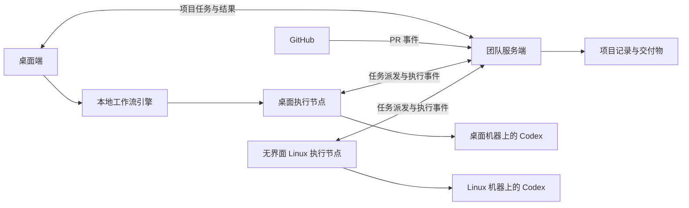

# Meshwork 设计文档

[English](design.md) · [仓库 README](../README.zh-CN.md)

本文描述 Meshwork 的首版设计。产品模型和部署方式来自项目讨论，技术选型和首版默认行为属于设计提案。

## 产品模型

Meshwork 管理在人和 AI Agent 之间交接的任务。用户或外部事件把任务交给 Bot，Bot 选用已配置的工作流，由流程引擎按规则推进。每次交接都记录谁完成了这一步、交付了什么、下一步由谁处理。

| 概念 | 含义 |
| --- | --- |
| 项目 | 共享工作空间，包含自己的团队、仓库、参考文档、Bot、任务和交付物。同一个账号可以加入多个项目。 |
| 成员 | 有 Meshwork 账号和项目权限的真实用户。成员可以接收任务、提交交付物、退回修改和审批交接。 |
| Bot | 归个人或项目所有的任务入口，绑定触发条件和工作流，并定义运行规则。项目 Bot 在项目时间线上有可识别的身份。 |
| 工作流 | 有版本的步骤定义，包括职责、输入、预期输出和流转规则。审查等职责可以绑定给真实成员，也可以配置为 Agent 步骤。 |
| 任务 | 一项具体工作，包含目标、上下文、验收条件、时间线和交付物。同一个任务可以有多次工作流运行。 |
| 运行和步骤尝试 | 一次运行对应指定版本的工作流。一次步骤尝试对应这次运行中的一次执行或人工提交。 |
| 执行器和执行节点 | 执行器完成 Agent 步骤，首版拟接入 Codex。执行节点是运行在目标机器上、负责启动和管理执行器的 Meshwork 进程。 |

## 个人 Bot 与项目 Bot

| | 个人 Bot | 项目 Bot |
| --- | --- | --- |
| 归属 | 用户在自己的桌面工作空间创建和管理。 | 由有权限的项目成员创建，归项目所有。 |
| 触发 | 用户从桌面端启动本地任务。 | 有权限的成员手动发起，或由已配置的项目事件触发。 |
| 上下文 | 本地目录、用户选取的文件和前序步骤的产出。 | 项目资源、触发事件和前序步骤的交付物。 |
| 执行 | 桌面执行节点使用本机的 Codex 和工作区。 | 团队服务端把 Agent 步骤派给符合条件的桌面或无界面 Linux 执行节点。人工步骤进入指定成员的待办。 |
| 结果 | 个人任务和历史保存在本地。 | 有权限的项目成员可以查看任务、共享交付物和审核历史。 |

两类 Bot 共用工作流定义和步骤规则。个人工作流可以在桌面端独立运行，无需登录团队服务端。项目工作流的共享状态由团队服务端维护，包括下一步指派。桌面设备所有者决定执行节点可参与哪些项目，以及是否自动接任务。

## 架构

**桌面端。** 创建个人 Bot 和工作流，加入项目并处理待办。每张任务卡显示当前步骤、负责人、相关执行事件和交付物。桌面执行节点负责本机执行，也可以接收已获授权的项目任务。

**团队服务端。** 管理账号、项目成员、共享资源、Bot 配置、工作流运行、人工指派和发布记录。接收项目事件，派发任务，并同步状态更新。两位成员在各自客户端看到的是同一份项目任务状态。

**执行节点。** 桌面执行节点和无界面 Linux 执行节点共用执行代码。每个节点管理自己的工作区、Codex 进程和执行器登录态。登记后的节点使用自己的凭据主动连接团队服务端。节点需要具备步骤要求的权限、工作区和执行器，才可以接收对应任务。只要节点进程和机器保持运行，当前步骤就可以独立于桌面窗口继续执行。

初步建议桌面端使用 Electron、React 和 TypeScript，桌面与 Linux 共用 Node.js 执行程序，团队服务端也使用 Node.js。个人工作流、任务和执行状态可保存在 SQLite。项目共享记录建议用 PostgreSQL，上传的交付物由独立文件存储保存。请求和 Webhook 使用 HTTPS，任务派发、进度和状态更新通过长连接传输。

## 工作流与交接

首版编辑器可以用有序步骤列表表示工作流，为成功、退回修改、失败和人工决定配置明确的流转规则。每一步定义执行器或负责人、所需输入、输出字段和下一步。审核可以把任务退回给实施者，设定返工上限，并在达到上限后转交人工处理。每次运行固定使用启动时的工作流版本。

流程引擎根据结构化的步骤结果决定如何推进。Agent 可以提交处理结论、摘要和证据。执行节点按步骤定义校验结果，并收集对应的交付物。Meshwork 先保存结果与必需的交付物，再推进流程。真实成员也能从任务卡提交同样结构的处理结果。如果缺少前置材料，步骤会记录缺少什么，等待后续补齐。

交接会把任务目标、本步验收标准、上一步结果和相关输入发给下一位执行者。项目步骤使用下一位执行者能访问的交付物，例如已保存的文档版本、测试报告，或能从项目仓库获取的 Git commit。事件和交付记录保留本次使用的版本。本地文件可以按需作为交付物附到项目任务上。

Meshwork 记录发起账号或自动触发来源、Bot、负责人、执行节点、步骤尝试和审批决定。项目成员可以查看和工作流相关的摘要与共享产出。执行器凭据和原始本地会话保留在执行机器上，由执行节点保存用于检查或恢复本次执行的会话和回合标识。

## Codex 接入

首个执行器适配器在选定节点上启动 Codex App Server，通过标准输入输出与之通信。新任务开启会话，恢复或继续上一步时可以续接已有会话。开始回合时传入本步的工作目录、上下文和输出结构。执行节点把 Codex 通知转换为 Meshwork 的进度、审批请求和最终状态。任务卡可以在最终结果旁展示相关的命令或文件活动。Codex 的权限审批控制底层操作，工作流审批决定项目如何流转或发布。两者分别记录在任务里。 [Codex App Server](https://developers.openai.com/codex/app-server)

Meshwork 有自己的任务、运行和步骤标识，并在执行节点上关联相应的 Codex 会话和回合。切换角色时，把明确的交接内容和指定的工作区版本交给对方。需要独立上下文的步骤使用独立会话。后续执行器可以实现相同的 Meshwork 接口来启动任务、上报进度、请求审批、取消执行和返回结果。

以下项目的实现分别为设计提供参考。

- Paseo 在 daemon 内接入 Codex App Server，并由 daemon 主动连接 Hub 接收任务。持久化的派发回执为重试和断线后的状态核对提供参考。 [Codex 适配器](https://github.com/getpaseo/paseo/blob/main/packages/server/src/server/agent/providers/codex-app-server-agent.ts) · [Paseo Hub 协议](https://github.com/getpaseo/paseo/blob/main/docs/hub.md)
- T3 Code 将执行器回合结束与保存工作区检查点等后续动作分别处理。Meshwork 将这个做法用在工作流交接和交付物保存上。 [T3 Code 架构](https://github.com/pingdotgg/t3code/blob/main/docs/internals/01_architecture.md)
- Orca 在持有 worktree 的环境中运行 Agent，并在支持的主机上提供结构化聊天。这个做法为 Meshwork 划分执行节点职责、设计任务执行详情提供参考。 [远程 Orca Server](https://orca.dev/docs/remote-servers) · [Orca 聊天界面](https://orca.dev/docs/agents/native-chat)
- Herdr 托管原生终端，通过集成 Hook 获取会话标识。后续接入主要通过终端使用的执行器时，可以参考这一模式。 [Herdr 集成](https://herdr.dev/tui/docs/integrations/)

## PR 审核示例

1. 项目管理员连接 GitHub 仓库，为审核 Bot 配置审核规则、可用执行节点和发布策略。项目授予仓库读取权限，启用发布时再明确授予 GitHub 连接的审核写入权限。
2. PR 创建或更新时，团队服务端收到事件，验证 Webhook 并定位项目、仓库和 PR，记录 PR 的最新提交、对比基准和工作流版本。服务端对重复投递去重，同一 Bot 对同一版本只自动启动一次。 [GitHub Webhook 事件与载荷](https://docs.github.com/en/webhooks/webhook-events-and-payloads#pull_request) · [验证 Webhook 投递](https://docs.github.com/en/webhooks/using-webhooks/validating-webhook-deliveries)
3. 选定的执行节点获取指定版本的 diff，使用项目规则运行 Codex 审核。默认审核步骤读取 diff 和相关文件。项目可以配置在隔离工作区执行测试，本次运行会记录实际做过的检查。
4. 执行节点提交结构化报告，包含摘要、可定位的文件与行号、审核发现及验证证据。报告显示在项目任务卡中，需要审批时交给指定的真实成员。
5. 启用发布后，由项目的 GitHub 连接发布符合策略的报告。首版建议默认生成项目内报告，可以配置经人工审批后发布。发布前，服务端确认报告仍对应当前 PR 的最新提交。旧报告留在任务历史，新提交启动自己的审核。 [GitHub PR 审核接口](https://docs.github.com/en/rest/pulls/reviews#create-a-review-for-a-pull-request)

## 可靠性与权限

- **派发与恢复。** 就绪的指派以稳定标识持久化。一次步骤尝试同时只能由一个执行节点认领。节点断线后，任务等待状态核对。重连后先根据节点的记录和执行器会话确认原尝试的结果，再决定是否发起新尝试。原结果仍无法确认时，任务卡显示这一状态，由有权限的成员决定如何继续。
- **结果与流转。** 在同一事务中保存已接受的步骤结果和下一步流转记录，附件使用持久化引用。外部发布保留单独的操作记录，遇到重复投递时可先核对已有发布结果。
- **项目权限。** 用户账号、已登记的执行节点和外部连接各用自己的身份。读取任务、提交结果、管理 Bot 或发布到 GitHub 时，校验项目成员和范围权限。每个执行节点的登记只覆盖它可服务的项目和工作区。
- **执行权限。** Codex 凭据保留在执行节点。仓库内容、diff 和文档作为步骤输入处理。可写路径、命令执行和审批由项目执行策略控制。审核默认使用读取权限，发布权限明确授予项目的外部连接。
- **离线处理。** 个人运行留在桌面端。项目等待离线节点时，团队仍可看到该步骤。需要常驻执行环境的工作流可以配置 Linux 执行节点。

## 首版验收

1. **个人工作流。** 在团队服务端未连接的情况下，创建本地 Bot，使用本机 Codex 执行有序工作流，在任务卡查看交付物和步骤历史。
2. **项目协作。** 用两个真实账号创建项目和项目 Bot，把一个步骤交给第二位成员。审批或退回结果在两个账号中同步显示，工作流按定义推进。
3. **项目 PR 审核。** PR 事件触发对指定提交版本的审核。符合条件的桌面节点和 Linux 节点都可以接收审核步骤，团队可以查看报告。重复投递时复用已有审核记录。更新 PR 后，新提交有自己的审核，旧报告留在历史里。
4. **执行恢复。** 执行节点在网络中断后重新连接，核对已有尝试，回传一份结果或明确的结果待确认状态。任务卡反映结果并保留操作记录。
